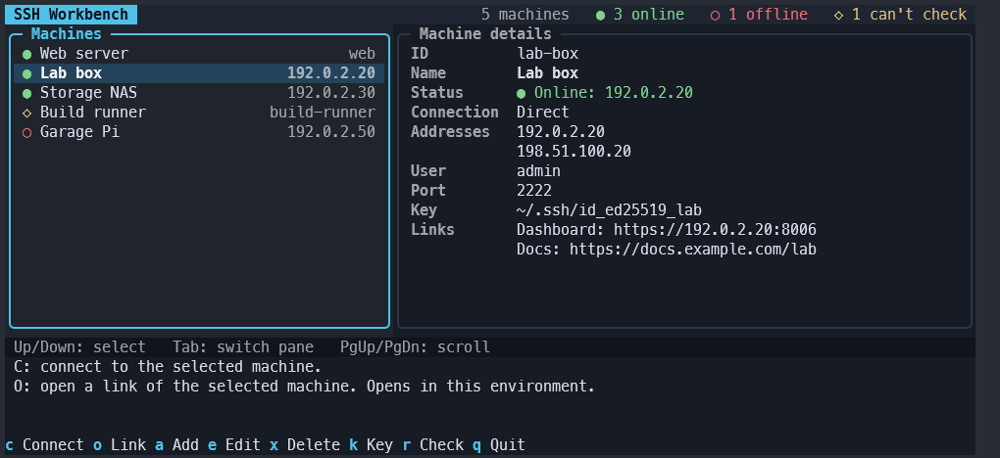

# SSH Workbench

A keyboard-driven terminal app for the machines you SSH into.


Keep a short list of machines, see at a glance which are online, and press
**C** to connect with your own OpenSSH client. When the session ends you are
back in the list with the same machine selected. Passwords, keys, the SSH
agent and host-key checks all stay with OpenSSH.



*Windows Terminal at 110x22 with fictional machines; the statuses come from a
stand-in checker.*

## Features

| Feature | What it does |
| --- | --- |
| Connect | **C** hands the terminal to `ssh` and takes it back when the session ends |
| Live status | Each machine shows Online, Offline or Checking, and the header counts them. Checks are TCP port checks, never logins, at startup, on **R** and every 30 seconds |
| Any terminal size | The layout rearranges itself for narrow and wide terminals, from 40 columns up |
| Manage machines | **A**, **E** and **X** add, edit and delete machines in a form that checks every value. Saves keep a backup |
| Key login setup | **K** picks or creates a key, installs it on a Linux, macOS or Windows target, and tests key-only login |
| Web links | **O** opens a machine's dashboard or docs in your browser |
| Renamed aliases | Notices when an SSH `Host` entry disappears, so a connect never goes somewhere you didn't choose, and offers the likely new name |
| Exported aliases | Makes `ssh <id>` work in any terminal for machines you added by address |

## Platform support

| Platform | Status |
| --- | --- |
| Windows 11 | Tested in Windows Terminal with real SSH hosts and browser links |
| Linux | Tested on Linux Mint 22.3 with a real SSH host, in a terminal reached over SSH; CI runs the tests on Ubuntu. Opening links needs a desktop with `gio` and is untested on a real desktop |
| macOS | Untested. Links report "browser unavailable" |

## Install

You need:

- [uv](https://docs.astral.sh/uv/getting-started/installation/), which
  downloads Python 3.14 or later for Workbench if you don't have it.
- The OpenSSH client: `ssh.exe` on Windows (the built-in "OpenSSH Client"
  optional feature), `ssh` elsewhere.

Install from GitHub (needs access to the private repository):

```text
uv tool install git+https://github.com/jkosber/ssh-workbench@v0.3.2
ssh-workbench --version
```

Or from a clone: `git clone https://github.com/jkosber/ssh-workbench.git`,
then `uv tool install .` inside it.

If your shell can't find `ssh-workbench`, run `uv tool update-shell` and open
a new terminal. The [user guide](docs/guide.md#install-upgrade-and-remove)
covers upgrading and removing.

## Quick start

1. Run `ssh-workbench` and press **A**.
2. Fill in an ID and a name. Choose **SSH alias** if `ssh <alias>` already
   works for the machine, or **Direct** to give its address, user and port.
   Press **Ctrl+S**: Workbench creates its machine file.
3. Select the machine and press **C**. Type `exit` in the remote shell to come
   back.

`ssh-workbench --help` shows where the machine file lives. You can also write
it by hand:

```toml
schema_version = 2

[[machines]]
id = "web"
name = "Web server"
alias = "web"

[[machines]]
id = "lab-box"
name = "Lab box"
user = "admin"
addresses = ["100.64.0.20", "192.168.1.20"]

[[machines.links]]
name = "Dashboard"
url = "https://192.168.1.20:8006"
```

The [schema](docs/guide.md#schema) lists every field, and
[examples/machines.example.toml](examples/machines.example.toml) has another
example.

## Keys

| Key | Action |
| --- | --- |
| Up / Down | Select a machine |
| Tab | Switch between the list and the details |
| C | Connect |
| R | Check every machine's status again |
| O | Open a link |
| A / E / X | Add, edit or delete a machine |
| K | Set up key login |
| Q | Quit |

The [user guide](docs/guide.md#keys) has the full list.

## Documentation

| Document | For | Contents |
| --- | --- | --- |
| [User guide](docs/guide.md) | Users | The machine file, every feature, troubleshooting and privacy |
| [Changelog](CHANGELOG.md) | Users | What changed in each release |
| [Contributing](CONTRIBUTING.md) | Contributors | Setup, daily commands and project rules |
| [Workflow](docs/workflow.md) | Contributors | How a task goes from idea to release |
| [Testing](docs/testing.md) | Contributors | Automated checks and manual terminal checks |
| [Architecture](docs/architecture.md) | Contributors | How the code is organized and why |
| [Roadmap](docs/roadmap.md) | Everyone | What is next, the backlog and what is done |
| [AGENTS.md](AGENTS.md) | Coding agents | Rules and commands for AI coding agents |

## License

MIT. See [LICENSE](LICENSE).
