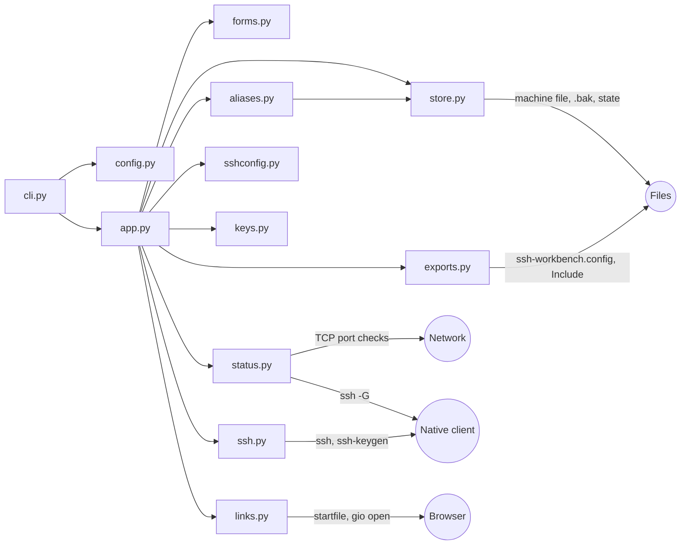

# Architecture

How SSH Workbench is built and why. What users see is in
[the user guide](guide.md); this document covers modules, boundaries and the
decisions behind them.

| Section | Covers |
| --- | --- |
| [Overview](#overview) | The modules and every outside effect |
| [Decisions](#decisions) | Toolchain choices |
| [CLI and startup](#cli-and-startup) | Arguments, the default file, errors before the screen |
| [Machine browser](#machine-browser) | The list, details, footer and rebuilds |
| [Machine file](#machine-file) | Loading, validation rules and the [Python API](#python-api) |
| [Editing and saving](#editing-and-saving) | Forms and the only file writes |
| [Live status](#live-status) | Port checks, `ssh -G` and rounds |
| [Rename detection](#rename-detection) | The state file and rename offers |
| [Exported aliases](#exported-aliases) | The generated SSH config and the `Include` line |
| [Key setup](#key-setup) | Key choice, the two remote commands and interruption |
| [Native SSH boundary](#native-ssh-boundary) | Arguments, executable lookup, terminal handoff |
| [Browser boundary](#browser-boundary) | URL dispatch and the link worker |
| [Packaging](#packaging) | The build and the installed-wheel check |
| [Security and privacy](#security-and-privacy) | The rules every change keeps |
| [Sources](#sources) | Documentation and source code checked |

## Overview

Workbench is one Textual application. Every action with an effect outside the
process (starting a process, opening a connection, opening the browser,
writing a file) goes through a small boundary module, so tests can substitute
each one. Reading the SSH folder is limited to `sshconfig`, `keys` and
`aliases`.



### Module map

| Path | Responsibility |
| --- | --- |
| `src/ssh_workbench/cli.py` | Entry point: help and version, default-file location, loading, starting the app |
| `src/ssh_workbench/config.py` | TOML loading and formatting, schema 1 and 2 validation, `Machine` and `Link` records and the shared field rules. No Textual, subprocesses or filesystem search |
| `src/ssh_workbench/store.py` | The only file writing: outside-change check, `.bak` copy and atomic replace of the machine file; `replace_atomically` also writes the alias state file |
| `src/ssh_workbench/aliases.py` | The alias state file and the rename review: which aliases vanished and the one new name each probably became |
| `src/ssh_workbench/sshconfig.py` | The SSH folder and the literal `Host` names from its `config` and `Include` files; nothing else is interpreted |
| `src/ssh_workbench/app.py` | Textual app: machine list, details, status lines, the link picker and the C/U/O/A/E/X/K/R/Q actions |
| `src/ssh_workbench/forms.py` | The machine form, the delete confirmation and the key-setup picker |
| `src/ssh_workbench/display.py` | Literal display of configuration text, with nonprinting characters escaped |
| `src/ssh_workbench/status.py` | The only network code: TCP port checks, the `ssh -G` alias resolver and the per-machine status rules |
| `src/ssh_workbench/ssh.py` | Native SSH boundary: machine recheck, argument list, executable lookup, child process and SIGINT guard |
| `src/ssh_workbench/exports.py` | Exported aliases: the generated `ssh-workbench.config`, the `Include` check and its one-line insert with a backup |
| `src/ssh_workbench/keys.py` | Key setup: public-key validation, the `.pub` listing, new key names, `ssh-keygen` arguments and the two fixed install commands |
| `src/ssh_workbench/links.py` | Browser boundary: URL recheck and operating-system dispatch |
| `src/ssh_workbench/__main__.py` | `python -m ssh_workbench` |
| `tests/` | Loader, CLI, boundary and headless UI tests with fictional data |
| `scripts/check_package.py` | Installs the wheel from `uv build` in a temporary environment and checks it |
| `scripts/package_smoke.py` | The installed-wheel loader, headless app, blocked-opener quit and first-save checks, run by `check_package.py` with `python -I` |
| `scripts/external_boundaries.py` | The shared list of process, network and browser entry points that tests, fixtures and the package check reject |
| `scripts/check_terminal.py` | Interactive terminal handoff check with harmless local children instead of SSH |
| `scripts/check_links.py` | Interactive link check with substituted openers; never opens a real browser |
| `scripts/check_keys.py` | Interactive key-setup check with local children and fictional keys |
| `examples/` | Fictional configuration |
| `.github/` | CI and the pull-request template |

`cli` imports `config` and, after argument parsing, `app`. `app` uses `forms`,
`store`, `sshconfig`, `status`, `aliases`, `keys`, `exports`, `display`, `ssh`
and `links`, which reuse validation from `config`; `aliases` writes through
`store`. Only `__main__` imports `cli`.

## Decisions

| Decision | Reason |
| --- | --- |
| Python 3.14.8 for development, minimum >=3.14 | A supported stable interpreter: 3.14.7 at bootstrap, 3.14.8 since Task 17 for its security fixes; one version keeps the CI matrix small |
| Textual as the only direct runtime dependency, below 9 | Terminal layout, keyboard handling and headless tests without a web backend; the terminal handoff was verified only on 8.2.8 |
| The look from Textual's own theme, CSS and breakpoints | No second UI library. pixel (pixelgui.com), considered in Task 20, is a TypeScript toolkit that runs on Windows only through WSL |
| Standard-library argparse and metadata | Help and version need no extra CLI framework or duplicated version constant |
| uv with its build backend and a `src/` layout | One tool for environments, a committed lockfile and installable artifacts; tests exercise an installed package |
| pytest plus pytest-asyncio; Ruff | Small test and quality toolset with the same commands locally and in CI |
| No database, telemetry, service account, cloud service or AI API | Nothing to run or trust besides the user's own SSH |

## CLI and startup

The installed `ssh-workbench` entry point calls `ssh_workbench.cli.main`.
Standard-library `argparse` handles help, version and invalid options before
reading configuration or loading the TUI. Version output uses
`importlib.metadata.version`; the source of that metadata is `pyproject.toml`.

An explicit `--config PATH` calls `load_machines(Path)` once and skips the
default file entirely. Without it, `default_config_path()` names the per-user
file:

| Platform | Default file |
| --- | --- |
| Windows | `%APPDATA%\ssh-workbench\machines.toml` |
| Others | `$XDG_CONFIG_HOME/ssh-workbench/machines.toml` when that variable is absolute, else `~/.config/ssh-workbench/machines.toml` |

The XDG specification says to ignore relative values; an unset or relative
`APPDATA`, or an unresolvable home folder, means no default location.
Resolution reads only environment variables and the home folder. The default
file is loaded when `Path.exists()` is true, so a folder at that path is
reported instead of hidden; a missing file leaves the app in its
no-configuration state, which shows the path. The 0.1.0 name `projects.toml`
is not checked. Nothing searches other folders, and loading never creates or
writes anything; only a save does.

A `ConfigError` becomes an argparse error on stderr with exit status 2, before
terminal startup. Default-file errors read `default configuration file:`
followed by the loader's message without its own `configuration:` prefix, so a
user can tell which file failed without the path being printed. `--help`
prints the resolved path on its own line in an epilog that
`RawDescriptionHelpFormatter` does not rewrap, escaped for display and for the
output encoding. argparse %-formats an epilog only when it contains
`%(prog)`, so `%` is doubled only then.

## Machine browser

`SSHWorkbenchApp(machines, config_path, file_text, checker)` receives
validated records in file order and the text they were read from. It retains
them in a tuple; `None` means no file was loaded and an empty sequence means a
loaded file contains no machines. Those states have different informative
screens, both naming `config_path`, escaped for display, when one exists: the
loaded file, or the default location, where the first save creates the file.
Only the no-file screen mentions `--config`. The app's only network calls are
the status checks in `status`; Connect delegates process I/O to the native SSH
boundary, O delegates URL dispatch to the browser boundary, and saves go
through `store`.

| Part | Rule |
| --- | --- |
| Theme | `WORKBENCH_THEME`, registered and selected in the app's constructor. Its design variables color the focus border, the list highlight and the footer keys. Status colors come from `$success`, `$error`, `$warning` and `$accent`, always on top of a distinct symbol |
| Header | One row: the title and `#app-summary`, which counts machines by state (Not checked left out) in words when they fit beside the title, else as symbols. `_update_summary` runs after every status change, rebuild and resize. Only app-generated counts carry styles; no machine data reaches it |
| List | A Textual `ListView` starts focused on the first machine. Rows shorten long names. Selection uses the list's highlight; focus uses the primary-colored border. Each row is a `StatusSymbol`, the name's `Static` and a `RowTarget` (the alias or first address), both small widgets rather than `Static`s so the name stays the row's only one |
| Details | The list's `Highlighted` event updates literal `Static` values in a `VerticalScroll` and resets it to the top, one `.field-row` per field: ID, name, status, connection kind, the alias or the addresses (one per line, under a label that changes with the kind), user, port, key and links (`name: URL` per line). Unset direct fields read `Not set`; alias machines read `From your SSH config`. Values wrap. `#machine-status` carries a `state-<name>` class for its color |
| Layout | `HORIZONTAL_BREAKPOINTS` give the screen `-narrow` (under 60 columns), `-normal` or `-wide` (110 and up); `VERTICAL_BREAKPOINTS` give `-short` (under 20 rows) or `-tall`. CSS on those classes stacks the panes and wraps the footer when narrow, shows `RowTarget`s when wide, hides the help line when narrow or short, and gives the link status two rows when short |
| Keys | Tab and Shift+Tab switch panes; details use Textual's standard scrolling keys |
| Footer | `KeyFooter`, Textual's compact footer, shows C / Connect, O / Link, A / Add, E / Edit, X / Delete, K / Key, R / Check and Q / Quit, with Ctrl+Q as an extra exit key. It ends before the last column, because Textual leaves the bottom-right cell empty on Windows. Footer sets one grid column per key; `KeyFooter` sets four, and narrow screens switch it to a two-row grid |
| Dimmed actions | `check_action` dims every action except quitting while connecting, while a modal screen is open and while the panes rebuild after a save; it also dims C, O, E and X without a selection, O for a machine without links, and A, E and X without a file location |
| Results | Link actions do not change pane focus or selection. Connect results end with `Machine N: <id>` so they name the machine |

The list, details and help line live in `MachinePanes`, a container whose
`compose` asks the app for its children. A save rebuilds that container with
`Widget.recompose`: `App.recompose` would rebuild whichever screen is active,
which can be an open form. Between a save and the rebuild the old list is
still mounted while the app already holds the new machines, so a `_rebuilding`
flag keeps actions and stale highlights off until the rebuild ends; the
rebuild then shows the saved machine's details and focuses the list on the
browser screen.

`_display_text` escapes nonprinting characters using Python-style
representations, including C0/C1 controls, formatting controls and
nonprinting separators. It is applied only when rendering; frozen `Machine`
and `Link` values remain untouched. Every configuration-derived `Static` uses
`markup=False`, and picker options are plain `Content`, with no link widgets
or Rich/Textual markup interpretation. Terminal-provided URL detection is
outside the application's control.

## Machine file

`ssh_workbench.config.load_machines(path: Path) -> list[Machine]` reads only
the explicit UTF-8 file and drops a leading byte-order mark, which Windows
PowerShell 5.1 and some editors write. A folder is reported as `expected a
file, got a directory` before reading, because Windows would otherwise say
"permission denied". `parse_machines(text)` uses standard-library `tomllib`,
checks `schema_version` first and then validates that version's schema. The
frozen `Machine` dataclass holds `id`, `name`, `alias`, `user`, `addresses`,
`port`, `key`, `links` and `export_alias`; `Link` holds `name` and `url`;
tuples keep them immutable and the list preserves file order. Neither loading
nor validation depends on Textual, subprocesses or network I/O. The loader has
no default path or discovery of its own; the CLI chooses which file to pass.

Schema 1 files load as alias machines: `ssh_alias` becomes `alias`, and
`repository` and `documentation` become links named "Repository" and
"Documentation" in that order. Their errors keep `projects[N]` locations, so a
0.1.0 file reports its field errors at the same locations as before. The
version message reads `expected integer 1 or 2`.

The [user guide's schema](guide.md#schema) and the
[fictional example](../examples/machines.example.toml) describe the supported
format. Policy choices:

| Decision | Reason |
| --- | --- |
| Reject unknown fields at every level; accept an explicit empty array | Catch spelling mistakes while allowing a valid file with no machines |
| Preserve strings; reject whitespace-only strings | Avoid changing display names or reference values silently |
| Require exact integer version 1 or 2 and unique, case-sensitive IDs | Python booleans are integers too; explicit checks preserve the TOML contract |
| Either `alias` or `addresses`; `user`, `port` and `key` only with `addresses` | An alias's SSH config already decides those values; mixing them would hide which one SSH uses |
| `user` and addresses never start with `-` and contain no whitespace, controls or `@`; addresses are hostnames, IPv4 or IPv6 without a `%` zone; digits-and-dots values must be valid IPv4 | Each value stays one SSH argument and cannot become an option or a second destination |
| Accept either platform's absolute key path, or `~/` and `~\` | A machine file in a synced folder can serve Windows and Linux |
| Reject `"`, `%`, `${`, controls and `.pub` in key paths | OpenSSH would expand `%` and `${}` after checking the raw path; a `.pub` file is never a private key |
| Unique link names within a machine; URLs keep the 0.1.0 rule | Names identify picker entries; the browser boundary rechecks the same URL rule |
| Validate HTTP/HTTPS scheme, host presence, credentials and port syntax and range | `urlsplit` separates components but is not a full URL validator |
| Reject raw whitespace, controls and backslashes before URL parsing | Parsers can discard controls and browsers can normalize backslashes; rejecting them avoids ambiguous input |
| Fail on the first error with one `ConfigError` type | Callers receive either complete validated data or an actionable failure |
| Use one-based positions and omit supplied values, paths and unknown key names in errors | Locate a problem without exposing private metadata; allowed field names and TOML line and column provide context |

The predicates `is_valid_machine_id`, `is_valid_ssh_alias`, `is_valid_user`,
`is_valid_address`, `is_valid_port` and `is_valid_key_path` are public so the
launch boundary and the edit forms apply exactly the loader's rules.

URL syntax checks do not establish DNS validity, reachability or trust in a
link's contents. Standard HTTP/HTTPS ports, queries, fragments and encoded
path spaces are supported; the original string is retained. All metadata stays
inert until an explicitly requested action uses it. The loader creates and
overwrites nothing, and underlying parser and file exception text is
suppressed.

### Python API

`load_machines(path)` reads UTF-8 TOML, with or without a byte-order mark, and
returns a `list[Machine]` in file order. Absent optional fields are `None`, or
an empty tuple for `addresses` and `links`. `parse_machines(text)` performs
the same parsing and validation on an existing string. Both report problems
through `ConfigError`. Neither uses the data to connect, run commands or open
links. From the repository:

```text
uv run --locked python -c "from pathlib import Path; from ssh_workbench.config import load_machines; print(load_machines(Path('examples/machines.example.toml')))"
```

Parsing checks TOML syntax; validation then checks the values against the
schema. `alias = "--help"` parses as TOML but fails validation at
`machines[1].alias`, because an alias cannot start with a dash. A missing
closing quote is a parsing error instead, reported with a line and column.
Errors identify a field and a one-based position where possible, omit file
paths, supplied values and unknown key names (unknown-field errors list the
allowed fields), and stop at the first problem without partial results.

## Editing and saving

A, E and X open `forms.MachineForm` or `forms.ConfirmDelete` as modal screens.
The form turns its fields into a table (addresses split on commas and spaces,
a port of digits made an integer, one link per line with the last word as the
URL, structured fields stripped) and checks it with `config.validate_machine`,
the loader's per-machine rules, plus a unique-ID check. It shows the first
problem under its field once that field changed or a save was attempted.
Ctrl+S and Escape are priority bindings handled in arrival order, and the form
answers once, so keys typed after a save cannot save twice.

The form hands a valid machine to the app, which calls
`store.save_machines(path, machines, expected_text)`:

| Step | Detail |
| --- | --- |
| Outside change | The current text is read the same way as when loading. If it differs from the text loaded (or the file appeared or vanished), `FileChangedError` stops the save. The app reloads the file and keeps the form open with a message; an invalid file is reported and nothing changes |
| Unchanged | When the new text equals the current text, nothing is written |
| Read-only | A file the user made read-only is refused with "permission denied" before anything is written, on POSIX as on Windows |
| Backup | The previous bytes go to `machines.toml.bak`, written like the file itself but with the default mode, so a read-only original never makes the backup read-only |
| Write | `config.format_machines` produces schema 2 TOML in a fixed layout, escaping every control character. The bytes go to a temporary file in the same folder, are flushed and fsynced, take the old file's mode on POSIX, and `os.replace` puts them in place. On Windows the mode is not copied, because it is only the read-only flag |
| Failure | The temporary file is made writable and removed, and a `SaveError` names only the reason, never the path |

A text comparison catches edits that keep the modification time, such as some
synced folders. Saving drops comments and hand formatting; when the loaded
text differs from `format_machines` of the loaded machines, the form's first
Ctrl+S says so and the second saves, and the delete question repeats the
warning. `parse_machines(format_machines(m)) == m` is tested for every record
shape.

The add form lists literal `Host` names from `sshconfig.host_names`. It reads
`config` in the SSH folder (`SSH_WORKBENCH_SSH_DIR` when absolute, else
`~/.ssh`) and follows `Include` lines: relative names from that folder, `~`
meaning its parent, globs in sorted order, up to OpenSSH's depth of 16, each
file once and at most 1 MB. Only `Host` and `Include` keywords are
interpreted; names with `*`, `?` or `!`, or that fail the alias rule, are
skipped. Include targets named `id_*`, `*.pub`, `*.pem`, `*.ppk`, `*.key`,
`known_hosts*` or `authorized_keys*` are never opened. Unreadable files are
skipped silently, because the names are only suggestions.

## Live status

The app checks only when given a checker: the CLI passes
`status.StatusChecker`, and tests pass fakes with the same two methods, so
every other test stays offline. With a checker the app runs a round on mount
and on R that also resolves aliases, and a round without resolving every
`STATUS_INTERVAL` (30 s) and after each save:

| Step | Detail |
| --- | --- |
| Round | Each machine becomes Checking and gets one daemon thread, as the link worker does (in a resolving round, alias machines only after the [rename review](#rename-detection)), so quitting never waits for a check stuck on DNS or a dropped connection. In a round without resolving, an alias with no `ssh -G` answer gets no thread and reads Can't check: press R. Results come back through `post_message` as `StatusFinished`; a status from an older round, or for a machine no longer listed, is dropped |
| Save during a resolving round | The round a save starts leaves the aliases that the startup or R review, or its `ssh -G`, still has to answer Checking, with no check of their own. The review and every `ssh -G` answer still apply whatever their round: R waits for all of them, so they always belong to the latest startup or R round. A late answer starts the port check of the machines still waiting for that alias; an alias the save added or changed waits for R |
| Direct machine | `check_machine` tries the addresses in listed order on the machine's port (22 when unset) and stops at the first that answers |
| Alias machine | `resolve_alias` runs `[ssh, "-G", "--", alias]` without a shell, with standard input closed, standard output captured, standard error discarded and a 10 s timeout; with `SSH_WORKBENCH_SSH_DIR` set it adds `-F <dir>/config`. It runs detached from the terminal (`CREATE_NO_WINDOW` on Windows, a new session on POSIX), so a `Match exec` command cannot draw over the screen. Only `hostname`, `user`, `port`, `proxyjump` and `proxycommand` are read; the host and user are never displayed. A proxied alias is Can't check, because a direct port test would say nothing about the real route |
| Port check | `port_open` opens a TCP connection with a 3 s timeout and closes it at once; any `OSError` is offline |
| Timer rounds | Reuse the saved `ssh -G` answers. An alias added or changed since the last resolve stays Can't check until R, because `ssh -G` evaluates `Match exec` lines; Workbench runs it only at startup and on R. A timer round is skipped while the current round still reviews aliases or has a check that hasn't reported, so a check slower than the interval still shows its result |
| R | Dimmed while a review or resolving check of any round, one a save replaced included, is still running, so R never starts a second set of `ssh -G` runs beside them; K's own `ssh -G` is not counted |
| Teardown | Timer rounds, animation ticks, status and link results and a pending rebuild do nothing once `App.is_running` is False: when Pilot's `run_test` tears the app down, Textual removes the screens while app timers and messages still run. A normal exit stops both first |
| Connect | A direct machine connects to the address its latest status found online, else the first listed |

`StatusSymbol` is a small widget, not a `Static`, so the name `Static` in a
row stays the first one. Each state has its own shape (`◐`, `●`, `○`, `◇`,
`×`, `·`) and a word in the details pane; color classes come on top. A 0.2 s
timer turns the Checking symbol and dims Online every other 0.8 s, leaves the
other symbols alone, and does nothing when `App.animation_level` is `none`
(`TEXTUAL_ANIMATIONS=none`).

## Rename detection

A resolving round (startup and R) with alias machines first starts one daemon
thread, before any alias is resolved. It loads the state file on the first
review, reads `sshconfig.host_names` and runs `aliases.review`, which needs
`ssh -G` only for names that could replace a missing alias. The app receives
`AliasesReviewed` and starts a resolving check for every alias that is not
missing. Missing ones become `State.NOT_FOUND` (`×`) with no `ssh -G` or port
check, and timer rounds keep them so. A failed review lets the round check
every alias not already missing; an alias the state file lists as missing
(`baselines`) stays missing, while one that vanished since the last run
cannot be told apart and is still checked. Timer rounds wait while a startup
or R round is still reviewing or resolving, and a save in that time keeps its
answers (see [Live status](#live-status)).

| Item | Rule |
| --- | --- |
| State file | `aliases.state_path`: `<stem>.state.<computer>.json` next to the machine file, with characters other than letters, digits, `.`, `_` and `-` in `platform.node()` replaced by `_`, so computers sharing a synced machine file keep separate states. JSON with `version` 1, the computer, `host_names`, per alias `host`, `user` and `port`, and `baselines`. Written through `store.replace_atomically` once the round's aliases have reported, only when its text changed and the machine file exists; an `OSError` is ignored, because the file is a cache |
| Reading | More than 1 MB, undecodable or invalid JSON, another version or computer, an invalid alias name, an empty host, a port outside 1-65535 or a bool, or any missing or extra key means no state. A machine file in a synced folder is shared by computers with different SSH configs, so one computer's names must not mark another's aliases missing |
| Missing | An alias recorded while it was a literal `Host` name and not listed now. Matching is exact: OpenSSH 10.5p1 and Windows OpenSSH 9.5p2 apply `Host lab-box` to `lab-box` but not to `LAB-BOX`. The record stays while the alias is missing, so Alias not found survives restarts |
| Offer | The first review that misses an alias stores the `Host` names of the review before it, when the alias was still listed, as its baseline. Each review then resolves the names not in the baseline, and the one that resolves to the same host, user and port is offered, so an offer can appear after an ambiguous or unresolved review. A name offered to two missing aliases is offered to neither |
| Form save | Saving a machine from the form (A or E) with a missing alias forgets that alias's record and baseline: the user kept it on purpose, for example after moving it into a pattern. Its status then waits for R. Saved while an R review runs, it stays kept when that review reports, and that R round resolves it |
| Keys | `check_action` hides C for a missing alias and hides U unless the selected machine has an offer, so the footer keeps at most seven keys. U saves only the selected machine, through `_save` with the forms' rewrite warning (a second U) and outside-change reload |
| Marker | After a review, an alias that is neither listed nor missing reads "(not in your SSH config)" in the details; it still connects |

## Exported aliases

`Machine.export_alias` (a TOML boolean, direct machines only, written only
when true) marks a machine for Workbench's own SSH config file. `_save` calls
`exports.write_exports` after every successful save of the machine file, and
`_rebuild` shows any `ExportError` after the save's own message.

| Item | Rule |
| --- | --- |
| Generated file | `ssh-workbench.config` in `ssh_folder()`: a header naming the machine file it comes from, then per exported machine `Host <id>`, `HostName <first address>`, `User` and `Port` when set, `HostKeyAlias <id>`, and `IdentityFile "<key>"` with `IdentitiesOnly yes` when it has a key. The key uses `/` for `\`, and `%` is doubled, though the loader already refuses `%`; a quote or control character raises `ExportError`. When the file names another machine file, `write_exports` leaves it alone and raises `ExportError` if this machine file has exports, so one SSH folder serves several machine files without either erasing the other's exports. Created only once something is exported, then rewritten at every save, atomically, `600` on POSIX |
| Include check | `exports.include_present`: after a leading byte-order mark, an `Include` keyword, any case, before the first `Host` or `Match`, naming `ssh-workbench.config` or a path ending in it. A commented line or one inside a block does not count |
| Insert | `exports.add_include`: back up the config to `config.ssh-workbench.bak`, then write `Include ssh-workbench.config` plus the file's own newline (`\r\n` when it has any) before everything, after a UTF-8 BOM if present, keeping every other byte and the POSIX mode. A missing config is created with the line, `600` on POSIX. A config that is a link or read-only is refused with the line to add by hand |
| Prompt | After a form save of an exported machine whose generated file was written, once the browser is the active screen, `ConfirmInclude` shows the line unless it is present or N was answered this session. Y inserts it; N is remembered until the app restarts |
| Conflicts | The form and the rename review read `sshconfig.host_names(folder, skip=<generated file>)`, so only the user's own `Host` names count; the form refuses an exported ID among them |

Exported machines still connect directly. `ssh -F <generated file> -G <id>`
with OpenSSH 10.5p1 and Windows OpenSSH 9.5p2 read the generated block,
including a quoted key path with a space; a relative `Include` in a `-F` file
would resolve against the real `~/.ssh`, so checks never pass one.

## Key setup

K opens `forms.KeySetup` with `KeyChoice` entries and returns a `KeyPlan`. For
an alias the app first runs `ssh -G` in a daemon thread, the one moment
besides startup and R that it may, to learn the alias's `identityfile` and
`identitiesonly`. The answer opens the picker only if nothing happened since
K: any screen change (`screen_change_signal`), terminal handoff
(`app_suspend_signal`) or move to another machine drops the wait, and the
selected machine must still equal the one K was pressed on. A second K on
that machine while it waits says so in the status line; K after a dropped
wait looks up again. The three steps then run in one `ssh_handoff` and
`suspend`, each through `ssh.run_native` with the terminal's own input and
output, and a printed `SSH Workbench:` line before each. A nonzero status
stops the steps.

| Item | Rule |
| --- | --- |
| Choices | A direct machine's own `key`; otherwise the alias's configured keys that have a valid `.pub` (with `~` as the SSH folder's parent), the folder's valid `.pub` files by name, and `id_ed25519_<id>` unless that name exists. `keys.public_key_files` reads `.pub` files only |
| Public key | `keys.parse_public_key`: one line of at most 16 KiB with no control characters; a known type; strict base64 whose length-prefixed strings use every byte and start with the same type. A comment outside `[A-Za-z0-9._@+-]` words, or longer than 100 characters, is dropped |
| Create | `ssh-keygen -t ed25519 -f <path> -C ssh-workbench-<id>`, where the file is `id_ed25519_<id>` with dashes turned into underscores; `ssh-keygen` is found like `ssh` on absolute PATH entries, and a lookup error becomes a launch error inside the handoff |
| POSIX install | `exec sh -c '<script>'`, so any login shell runs it: `umask 077`, create `~/.ssh` and `authorized_keys`, `chmod 700`/`600`, and append the key line unless `grep -qF` finds its base64 on a line whose first non-blank character is not `#` (both greps with `LC_ALL=C`, so lines with non-UTF-8 bytes still count), adding a newline first when the file lacks one. The script holds no single quote and no `!`; the key line sits in double quotes |
| Windows install | `powershell -NoProfile -NonInteractive -EncodedCommand <UTF-16LE base64>`, so cmd.exe and PowerShell default shells run the same script, with `$ProgressPreference = 'SilentlyContinue'` so no CLIXML progress record reaches the terminal. Comment lines are skipped when looking for the key. An identity whose claims include `S-1-5-32-544` (deny-only included) uses `%ProgramData%\ssh\administrators_authorized_keys`, then gets an ACL with only FullControl for `S-1-5-32-544` and `S-1-5-18`, inheritance removed, checked by reading it back; others use `%USERPROFILE%\.ssh\authorized_keys` |
| Windows command length | Windows sshd runs a command as `"c:\windows\system32\cmd.exe" /c "<command>"`, and cmd.exe takes a command line of at most 8191 characters, so the command may have 8156. A key that would make it longer, an RSA key over 6008 bits with a 100-character comment or over 6608 bits with none, is refused before the handoff; a 4096-bit RSA key fits |
| Install arguments | `ssh.install_arguments`: `RemoteCommand=none`, since SSH refuses a command next to an alias's own `RemoteCommand`; the connect arguments without `-i`, since the new key is not installed yet; then the command after the destination |
| Login test | `ssh.login_test_arguments`: `PreferredAuthentications=publickey`, `PasswordAuthentication=no`, `KbdInteractiveAuthentication=no`, `ControlPath=none` so a connection the install left open can't skip authentication, `RemoteCommand=none`, the connect arguments (a direct machine with the chosen key and `IdentitiesOnly=yes`), then `exit`. No `BatchMode`, so a passphrase key works |
| Afterwards | A direct machine's chosen key is saved through `_save` once its login test passes, as `~/.ssh/<name>` in the real SSH folder or an absolute path; otherwise the result says it was not saved. For an alias, a key its config does not name carries the `IdentityFile` line in the picker and in the test's result, passing or failing |
| Interruption | A step is interrupted when its status is one `ssh.interrupted` names (a POSIX child killed by SIGINT, 0xC000013A or 0xFFFFFFFF), or when `ssh.ctrl_c_count()`, which the shield raises for each Ctrl+C, changed since just before the handoff: Windows ssh can exit 0 after Ctrl+C. Once it changed, no later step starts. Windows runs the parent's handler on a thread of its own, which can lose the race with a child's exit, so the count is read again once the terminal is handed back, and a passing test then reads as interrupted. ssh-keygen or the install then reads "Key setup interrupted."; the login test, "The key was installed, but the login test was interrupted." ssh-keygen's passphrase prompt on Windows takes Ctrl+C as a key, so the shield never sees it there; SSH's own prompts are unchecked. Connect reports statuses as they are |

## Native SSH boundary

`ssh_workbench.ssh.launch_ssh(machine, address=None)` is synchronous and runs
on the main thread. `ssh_arguments(machine, address)` first rechecks the
machine with the loader's own predicates, before executable lookup:

| Machine | Arguments after the executable |
| --- | --- |
| Alias | `--`, alias |
| Direct | `-o HostKeyAlias=<id>`, then `-l <user>`, `-p <port>` and `-i <key> -o IdentitiesOnly=yes` when set, then `--` and the address |

The address defaults to the first listed one and must be one of the machine's
addresses. `--` ends option parsing as a second safeguard behind validation;
Windows OpenSSH 9.5p2 and portable OpenSSH 10.5p1 accept it before hostname,
IPv4 and IPv6 destinations, and still refuse `-- -oProxyCommand=x` as an
invalid hostname. `HostKeyAlias` checks one `known_hosts` entry per machine,
whichever address is used. A key starting with `~/` or `~\` is expanded with
`Path.home()`, splitting the rest on either separator, because OpenSSH expands
only `~/`; the rules keep that rest inside the home folder (no second root or
drive). Other keys pass unchanged. OpenSSH checks that the raw `-i` path
exists before expanding `%` and `${}` codes, so the rules reject those
characters rather than escaping them. Workbench never opens the key file.

| Step | Rule |
| --- | --- |
| Lookup | `shutil.which` finds `ssh.exe` on Windows or `ssh` elsewhere, explicitly an executable rather than a batch file. On Windows, `shutil.which` checks the current directory before `PATH` unless `NoDefaultCurrentDirectoryInExePath` is set, and a relative `PATH` entry has the same effect anywhere, so a relative result is discarded and only absolute `PATH` entries are searched: an `ssh.exe` in the launch folder never runs |
| Process | The absolute path and the arguments form the entire argument list. `subprocess.run` uses `shell=False`, `check=False` and inherited stdin, stdout and stderr. No timeout, pipe, new process group or new session interferes with native SSH's terminal behavior |
| Errors | Missing executables and OS launch errors become sanitized `SSHLaunchError` messages. A started client's integer return code is returned unchanged, including nonzero or negative signal statuses. Output, authentication and SSH configuration belong to the native client |
| SIGINT shield | `ssh_handoff` installs a callable SIGINT handler in the parent and restores the exact prior handler in `finally`. The app uses it across suspension, lookup, child execution and resumption; the standalone launcher also uses it, nesting safely inside the app's guard. This shields Textual's asyncio task even during slow executable lookup or driver transitions. The child receives normal Ctrl+C behavior: `SIG_IGN` could make the child inherit ignored interrupts. SSH can handle Ctrl+C and keep running, so the parent waits for the child to exit rather than treating Ctrl+C as an exit |

The app has one Connect action, bound to C and shown in the footer. It
requires a selection and guards against reentrant launches. The synchronous
action enters `App.suspend()`, invokes the boundary and records the result.
Expected launch errors and `KeyboardInterrupt` are caught **inside** the
suspension block: installed Textual 8.2.8 resumes after a bare `yield`,
without a `finally`, so an escaping exception would skip restoration.
`SuspendNotSupported` is handled outside the block without launching a
process. Afterward the selection and details scroll remain intact, focus
returns to the list, the launch guard clears and a literal status message
naming the machine appears below the panes, with neutral retry guidance after
a nonzero exit or an interruption.

Headless tests keep the installed `App.suspend` implementation and substitute
only the driver's terminal methods to assert suspend, launch and resume
ordering. `scripts/check_terminal.py` replaces resolution and process
invocation with fixed local Python children and exercises the real terminal
handoff, including a child that continues after Ctrl+C, without SSH. Its
results are platform-specific; see [testing](testing.md#terminal-handoff-scriptscheck_terminalpy).

## Browser boundary

`links.open_link(url)` returns one `LinkResult`: missing, invalid,
unavailable, failed or accepted. It reuses `config.validate_http_url`, the
loader's own check, so no lookup, process or browser action occurs for invalid
input. Accepted URLs remain exact data: no query or fragment normalization,
fetching, redirect handling or page-existence check.

| Platform | Dispatch |
| --- | --- |
| Windows | `os.startfile(url)` dispatches through the URL association, as Python's `webbrowser.WindowsDefault` does |
| Linux with `DISPLAY` or `WAYLAND_DISPLAY` | `shutil.which("gio")` finds the desktop helper, and `subprocess.run([executable, "open", "--", url], shell=False, check=False, ...)` waits for its dispatch result. All three streams use `DEVNULL` and the helper starts a separate session. A zero status is acceptance, not page loading |
| Others, or Linux without a desktop or GIO | Unavailable |

OS errors become safe results; no exception text or helper output is shown. No
browser executable, flags or commands come from metadata. Generic
`webbrowser.open` and `xdg-open` are deliberately avoided because they can
fall back to text browsers. There are no `BROWSER` overrides, automatic
retries, system preference changes or forwarding to a terminal client.
Dispatch uses the environment running Workbench, including its browser
associations; the app cannot inspect external page state.

O opens a machine's only link directly. With several links it pushes
`LinkPicker`, a `ModalScreen` with an `OptionList` of `name  URL` prompts:
Enter dismisses it with the highlighted link and Escape with none. Textual's
modal binding chain hides the app's bindings, so C and O cannot run while it
is open; the picker repeats Q and Ctrl+Q so quitting still works. The chosen
link becomes a frozen `LinkRequest` holding the machine, the `Link` and the
one-based list position.

| Worker rule | Detail |
| --- | --- |
| One daemon thread | Calls the boundary; repeated actions get a pending message without opening a picker or starting another request. Installed Textual 8.2.8 thread workers use asyncio's default executor, whose shutdown can wait for blocked calls; the daemon avoids that quit delay |
| Messages | The thread communicates only through Textual's thread-safe `post_message`. The event handler alone updates UI state, accepts only the current request identity, and never restores selection or focus |
| Layout | A fixed three-row link status keeps completion from resizing the panes; a machine number stays visible even if its ID clips. The separate SSH status cannot be overwritten by a link completion |
| Shutdown | Unmount sets a thread-safe shutdown event and clears the request. The thread checks it before dispatch and before posting; closed-loop posting errors are discarded. A dispatch already past the check may still run. Quitting does not wait for the daemon, cancel an OS request, kill the helper or close a browser. Browser actions install no signal handlers and do not suspend Textual |

`scripts/check_links.py` supplies fictional cases, stubs OS dispatch and
guards other execution and network entry points; it never opens a real
browser or runs SSH. Its standalone entry point installs all guards before
constructing the app and keeps them until process exit, including after a
normal return or an exception: scoped teardown could restore a real opener
while a delayed daemon still runs. Importing the module installs nothing.
Isolated child tests hold a worker before dispatch, unwind the entry point,
then release it into the still-active fixture guards.

## Packaging

`uv build` builds the source archive and wheel. The package check installs the
wheel and the locked runtime dependencies in a disposable environment outside
the checkout, where it checks help, version, missing-configuration errors and
the loader. The checks that import the installed package live in
`scripts/package_smoke.py`; each run starts with isolation and module-path
assertions, and Python `-I` with `PYTHONPATH` deliberately naming the checkout
proves the wheel is imported.

The smoke checks substitute the terminal-run boundary with Textual's headless
pilot to exercise CLI loading, initial selection, navigation and quit at
80x24. Common process, connection and browser entry points fail them if
called. During Connect checks, only executable resolution and the process
runner are substituted, so installed suspension code exercises success,
nonzero exit, launch error and interruption. Link checks replace the opener
and exercise outcomes from both panes. Separate isolated processes verify that
Q and Ctrl+Q exit with a permanently blocked opener. The package check does
not establish native terminal behavior or launch real SSH.

## Security and privacy

Native SSH handles credentials, agents, the user's SSH configuration and
host-key checks. Workbench does not store passwords or private keys, parse
private keys or disable host-key verification. Tests never read real SSH files
or reach real hosts; the suite points `SSH_WORKBENCH_SSH_DIR`, `APPDATA` and
`XDG_CONFIG_HOME` at an empty folder.

0.2.0 deliberately replaced four 0.1.0 rules; these are the rules now:

| 0.1.0 rule | Now |
| --- | --- |
| Never writes configuration | Writes its own machine file and `.bak` copy, only from A, E, X, U or K, with the change check and atomic replace above, and its alias state file next to them. For exported machines it writes its own `ssh-workbench.config` in the SSH folder, and adds one `Include` line at the top of the user's SSH config only after Y, with a backup first; it never changes any other line of that config |
| No network I/O of its own | TCP port checks for status only: a DNS lookup for a host name, then one connection per checked address to its SSH port, closed without sending data; no ICMP. Tests substitute `socket.create_connection` and the `ssh -G` process |
| No remote commands | Exactly two built-in remote actions, both in the handed-off terminal: the key-install command and `exit` for the public-key-only login test. Their only variable part is a validated public key line; no command text comes from the machine file |
| Never reads SSH configuration | Lists and reads `.pub` files in the SSH folder for key setup, never a private key. Reads `Host` and `Include` lines of the user's SSH config to suggest aliases, and runs `ssh -G` for alias machines, and for new `Host` names that could replace a missing alias, at startup, on R and at key setup, which evaluates the whole config including `Match exec`; only `hostname`, `user`, `port`, `identityfile`, `identitiesonly`, `proxyjump` and `proxycommand` are read from its output. Never opens an included file named like a key, `known_hosts` or `authorized_keys`, and changes the SSH config only by the one confirmed `Include` line |

| Area | Rule for every change |
| --- | --- |
| Subprocesses | Validate aliases, users, addresses, ports and key paths as data; use an argument list with a resolved executable and `shell=False`. Reject values that could be flags, commands or several arguments, revalidate them at the boundary, and put `--` before the destination. Never build shell command strings from machine data or accept SSH flags or remote commands from configuration. `HostKeyAlias` changes where SSH records a host key, never whether it checks one |
| Metadata | Untrusted input: display it as plain text, report validation errors without dumping file contents, and validate URL schemes before opening links. Opening a URL or connecting to a host follows an explicit user action. Never log secrets or raw authentication output |
| Repository | Fictional fixtures and temporary files for tests. Private configuration, inventories and machine-specific notes stay in ignored `.local/`; review every staged file, because ignore rules are only one boundary. Committed docs use portable relative links and no private vault or lab paths |

## Sources

### Documentation

| Topic | Source |
| --- | --- |
| TOML parsing and errors | [Python tomllib](https://docs.python.org/3.14/library/tomllib.html), [TOML 1.0 basic strings](https://toml.io/en/v1.0.0#string) |
| URL parsing limits | [Python urllib.parse security](https://docs.python.org/3.14/library/urllib.parse.html#url-parsing-security) |
| Processes and signals | [subprocess](https://docs.python.org/3.14/library/subprocess.html), [subprocess.run timeouts](https://docs.python.org/3.14/library/subprocess.html#subprocess.run), [signal](https://docs.python.org/3.14/library/signal.html) |
| Windows console | [Console handler inheritance](https://learn.microsoft.com/en-us/windows/console/setconsolectrlhandler), [Ctrl+C delivery](https://learn.microsoft.com/en-us/windows/console/ctrl-c-and-ctrl-break-signals) |
| Browser dispatch | [Python webbrowser](https://docs.python.org/3.14/library/webbrowser.html), [os.startfile](https://docs.python.org/3.14/library/os.html#os.startfile), [GIO open](https://github.com/GNOME/glib/blob/main/gio/gio-tool-open.c) |
| Files | [os.replace](https://docs.python.org/3.14/library/os.html#os.replace), [tempfile.mkstemp](https://docs.python.org/3.14/library/tempfile.html#tempfile.mkstemp), [json](https://docs.python.org/3.14/library/json.html), [platform.node](https://docs.python.org/3.14/library/platform.html#platform.node) |
| Network | [socket.create_connection](https://docs.python.org/3.14/library/socket.html#socket.create_connection) |
| OpenSSH | [ssh(1)](https://man.openbsd.org/ssh) (`-l`, `-p`, `-i`, `-o`, `-G`), [ssh_config(5)](https://man.openbsd.org/ssh_config) (`Host` patterns, `Include`, first obtained value wins, `%` tokens in `IdentityFile`, `HostKeyAlias`, `IdentitiesOnly`, `PreferredAuthentications`, `ProxyJump`, `ProxyCommand`, `Match exec`) |
| Windows OpenSSH | [Key-based authentication](https://learn.microsoft.com/en-us/windows-server/administration/openssh/openssh_keymanagement) (updated 2026-04-21), [server configuration](https://learn.microsoft.com/en-us/windows-server/administration/openssh/openssh-server-configuration): `administrators_authorized_keys`, its ACL, SIDs for localized group names, cmd.exe as the default shell, ssh-agent disabled by default |
| PowerShell | [`-EncodedCommand`](https://learn.microsoft.com/en-us/powershell/module/microsoft.powershell.core/about/about_powershell_exe) |
| Textual | [App lifecycle](https://textual.textualize.io/guide/app/), [testing](https://textual.textualize.io/guide/testing/), [ListView](https://textual.textualize.io/widgets/list_view/), [Static](https://textual.textualize.io/widgets/static/), [suspend](https://textual.textualize.io/api/app/#textual.app.App.suspend), [workers](https://textual.textualize.io/guide/workers/), [screens](https://textual.textualize.io/guide/screens/), [OptionList](https://textual.textualize.io/widgets/option_list/), [animation](https://textual.textualize.io/guide/animation/) |
| uv | [Build backend and src layout](https://docs.astral.sh/uv/concepts/build-backend/), [GitHub Actions](https://docs.astral.sh/uv/guides/integration/github/) |
| Python releases | [3.14.8 release](https://www.python.org/downloads/release/python-3148/), [3.14.8 changelog](https://docs.python.org/release/3.14.8/whatsnew/changelog.html) |

### Installed source and local runs

These findings are version-specific. Check them again when the version
changes.

| Version | Finding |
| --- | --- |
| Textual 8.2.8 | `App.suspend` resumes after a bare `yield` without a `finally`; standard output goes to the real terminal while suspended. The Windows and Linux drivers were read for exceptional restoration and signal handling (reading the Linux driver is not a Linux terminal test) |
| Textual 8.2.8 | Thread workers use asyncio's default executor (`loop.run_in_executor(None, ...)`), so cancelling one does not stop a blocked opener and can delay interpreter shutdown |
| Textual 8.2.8 | `check_action` returning False hides a binding and stops it running; returning None dims it. Modal screens hide the app's bindings. Priority bindings in modal screens are handled in arrival order |
| Textual 8.2.8 | `Widget.recompose` rebuilds one container, `App.recompose` the active screen. `Screen.set_focus` on an inactive screen, `RadioSet` (Space and Enter toggle), `TextArea`, `SuggestFromList`, `Checkbox` (`Changed`, a one-line label) and `OptionList` highlighting were read before use |
| Textual 8.2.8 | `Vertical` defaults to `height: 1fr`, which squeezed the form's connection fields until they got `height: auto` |
| Textual 8.2.8 | `set_interval`, `animation_level`, the compact `Footer`, and the `_animate` attribute that a subclass must not reuse; every private name on the app was checked against Textual's |
| Textual 8.2.8 | List selection events, focus, literal rendering and the details pane's scrolling bindings |
| Textual 8.2.8 | `Screen._on_resize` sets the breakpoint classes from `App.HORIZONTAL_BREAKPOINTS` and `VERTICAL_BREAKPOINTS`; a browser resized behind an open form still had the right classes when the form closed, headless and in Windows Terminal. `Theme` takes design variables (`border`, `border-blurred`, `footer-*`, `block-cursor-*`); `Content.assemble` keeps `$variable` styles as spans |
| Textual 8.2.8 | `Footer.compose` sets `grid_size_columns` to the number of keys before yielding them, so a subclass can override it after `super().compose()`; the footer's own layout is horizontal until CSS makes it a grid |
| Python 3.14.7 | `webbrowser.WindowsDefault` uses `os.startfile`; asyncio and subprocess sources were read for signal handling; `argparse` formats an epilog with `%` only when it contains `%(prog)` |
| Python 3.14.8 | The changelog and the CPython `v3.14.7..v3.14.8` diff change `asyncio` transports, `start_tls` hostname checks and call-graph records, and `str()` of `subprocess.CalledProcessError`; nothing in `webbrowser` or `argparse`. `asyncio/runners.py`, `signal`, `subprocess.run` and `Popen.wait`, `os.startfile`, `webbrowser` and `argparse` are unchanged, so the 3.14.7 notes still hold. A Windows console read that Ctrl+C cancels now starts over (gh-72353); Workbench reads no console input itself, and Textual reads it through `ReadConsoleInputW` |
| OpenSSH 10.5p1 and Windows OpenSSH 9.5p2 | Run with `-F none -G`, which reads no configuration and connects nowhere, on the exact argument lists `ssh_arguments` builds. `Host` matching is case-sensitive. `ssh -F <fictional file> -G` printed `identityfile` with `~/` unexpanded and the default list when none is configured |
| Win32-OpenSSH (`w32-doexec.c`, `pwd.c`) | Windows sshd starts the default shell as `"c:\windows\system32\cmd.exe" /c "<command>"`; cmd.exe counts that whole line against 8191 characters (read, and measured locally with `cmd.exe /c`) |
| Linux | Browser dispatch is covered with substituted boundaries; it has not run on a Linux desktop |
