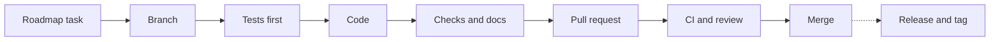

# Workflow

How a change goes from an idea to a release. Written for Jadon first and for
any later contributor; coding agents follow the same steps.

## The short version



1. **Pick a task** from the [roadmap](roadmap.md). One task is one branch and
   one pull request.
2. **Branch** from an up-to-date `main`.
3. **Write the tests first** and commit them failing, then commit the code
   that makes them pass.
4. **Check and document**: run the checks, update the docs the change
   touches, and move the task's roadmap row to Done.
5. **Open a pull request.** CI runs on Windows and Ubuntu, and a fresh review
   reads the whole branch.
6. **Merge** when CI is green and Jadon approves. Nothing needs recording
   afterwards: GitHub keeps the PR, its CI runs and the merge.
7. **Release** when enough has merged and Jadon decides to, with
   [the release checklist](#releasing).

## Words used here

| Word | Meaning |
| --- | --- |
| Task | One numbered unit of work in the roadmap, with acceptance criteria. Tasks are numbered in order and never reused |
| Branch | A separate line of commits for one task, such as `feat/task20-ui-makeover` |
| Commit | One saved change on a branch, with a short message |
| Pull request (PR) | A request to merge a branch into `main`. It shows the changes, the CI results and the review |
| CI | The GitHub Actions checks that run on every push, on Windows and Ubuntu |
| Review | A fresh read of the whole branch, by a person or a new agent session, before merging |
| Merge | Putting a pull request's commits into `main` |
| Release | A version number given to `main` at a moment, such as 0.2.2, with a changelog entry |
| Tag | A Git label on the release's commit, such as `v0.2.2`; installs use it |
| Changelog | [CHANGELOG.md](../CHANGELOG.md): what changed for users, release by release |
| Validation log | [validation.md](validation.md): what was checked by hand, which CI cannot show |

## Who decides what

Jadon decides; coding agents ask before every step marked "ask".

| Action | Rule |
| --- | --- |
| Choose or start a task | Jadon decides |
| Commit on the task's branch | Allowed once the task has started |
| Push and open a pull request | Ask, unless Jadon said so when starting the task |
| Merge a pull request | Ask |
| Change the version, tag or release | Ask, each one separately |
| Use a real SSH target or open a real URL | Ask, naming the target |
| Change repository visibility or publish anything | Ask; see [publishing](publishing.md) |
| Change infrastructure | Ask |

## Doing a task

### Start

```text
git switch main
git pull
git status --short --branch
git switch -c feat/task20-ui-makeover
```

| Branch prefix | For |
| --- | --- |
| `feat/` | New behavior |
| `fix/` | Bug fixes |
| `docs/` | Documentation only |
| `test/` | Test-only changes |
| `ci/` | CI and build tooling |
| `release/` | A release |

Move the task to **Now** in the roadmap with its acceptance criteria. For a
task with several steps, a coding agent writes a short plan in `.local/plans/`
(ignored by Git) first.

### Commit

| Prefix | For |
| --- | --- |
| `test:` | Tests, committed failing before the code they test |
| `fix:` / `feat:` | The code that makes those tests pass |
| `docs:` | Documentation |
| `release:` | Version and changelog date |
| `ci:` / `build:` | CI and packaging |

| Rule | Why |
| --- | --- |
| Tests and code in separate commits, tests first | The history shows each test failing before the fix, so it proves something |
| Stage named files only (`git add PATH`), never `git add -A` | Keeps private and stray files out |
| Commit as Jadon (his global Git identity), with no AI attribution lines | One author, as on every commit so far |
| Small commits with short messages | Easy to review and to revert |

### Finish

- [ ] The [checks](testing.md#automated-checks) pass locally.
- [ ] If the screen, terminal handoff or SSH changed: the matching
  [manual checks](testing.md#manual-checks-in-a-real-terminal), recorded in
  the [validation log](validation.md).
- [ ] Docs updated where behavior changed: the [user guide](guide.md), the
  README for anything on it, the [architecture](architecture.md) for
  structure or boundaries, [AGENTS.md](../AGENTS.md) for rules.
- [ ] A line under **Unreleased** in the [changelog](../CHANGELOG.md) for
  every change a user would notice.
- [ ] The task's roadmap row moved to **Done**, with the PR link once the PR
  exists.
- [ ] `git diff` read once more for leftovers and accidental changes.

Then push, open the pull request (the template asks for purpose, checks and
docs), wait for CI on both systems and get a fresh review. Fix every critical
and important finding before merging. Merge on the tested commit only:

```text
gh pr merge <number> --merge --match-head-commit <full head SHA>
```

After the merge:

```text
git switch main
git pull
git branch -d <branch>
```

That is the end of the task.

## Releasing

A release gives `main` a version number. Releases get no roadmap task number;
this checklist is the whole procedure.

### Versions

The version lives only in `pyproject.toml`; `--version` reads it from the
installed package. It changes only at a release, never per edit or session.

| Version | Meaning |
| --- | --- |
| 0.0.1 | Development scaffold before the first release |
| 0.1.0 | First usable release, tagged privately |
| 0.2.0 | Machines replace projects, tagged privately |
| 0.2.1 | Key setup fixes from real use, tagged privately |
| 0.2.2 | Ctrl+C, large-key and status fixes, tagged privately |
| 0.2.x | Planned: further fixes only |
| 0.3.0 | Planned: the next release with new features |
| 1.0.0 | A deliberately chosen stable release, later |

Until 1.0.0, the changelog states every compatibility change.

### Checklist

1. Jadon chooses the version. A public release first needs the
   [publishing checklist](publishing.md).
2. Branch `release/X.Y.Z` from `main`.
3. Set `version` in `pyproject.toml`, run `uv lock`, then `uv sync --locked`.
   The lockfile should change only in Workbench's own version.
4. Update every line that names the current release:
   `git grep -n "<previous version>"` finds AGENTS.md, the install commands in
   the README and the user guide, and the version table above.
5. In the changelog, rename **Unreleased** to `## X.Y.Z - YYYY-MM-DD` (the
   day the tag will be made) and add an empty **Unreleased** above it.
6. Run the full checks, a fresh `uv build` and the package check. Install the
   wheel as a tool in ignored folders (set `UV_TOOL_DIR` and
   `UV_TOOL_BIN_DIR` under `.local/`) and run the
   [app smoke check](testing.md#app-smoke-check) with it in Windows Terminal.
7. Pull request, CI, review and merge, as for a task.
8. Tag the merge commit and push the tag (ask first):

   ```text
   git tag -a vX.Y.Z -m "Release X.Y.Z" <merge commit>
   git push origin vX.Y.Z
   ```

9. Check that `uv tool install git+https://github.com/jkosber/ssh-workbench@vX.Y.Z`
   prints the new version and that the tag's CI passed.
10. Upgrade your own tool with the same command plus `--reinstall`.

A GitHub Release or a package upload happens only when Jadon asks for one.

## Where things live

| What | Where | Updated |
| --- | --- | --- |
| Tasks and backlog | [docs/roadmap.md](roadmap.md) | When a task starts and when it finishes |
| User-visible changes | [CHANGELOG.md](../CHANGELOG.md), under Unreleased | With each such change |
| Hand-run evidence | [docs/validation.md](validation.md) | When a manual or real-target check runs |
| How the code works | [docs/architecture.md](architecture.md) | When structure or boundaries change |
| User documentation | [README.md](../README.md), [docs/guide.md](guide.md) | When behavior changes |
| Rules for coding agents | [AGENTS.md](../AGENTS.md) | When a rule changes |
| Plans and scratch files | `.local/` (ignored by Git) | Any time |
| Pull requests, CI runs, merges, tags | GitHub | Automatically |
| Personal notes and context | Jadon's Obsidian vault, outside the repository | Any time |
| Tasks 1-18 in full | [docs/archive/](archive/) | Never |

## What changed on 2026-10-22

Task 19 simplified the workflow that had grown through Tasks 1-18:

| Before | Now |
| --- | --- |
| Each task's first commit recorded the previous PR's merge, CI run numbers and ticked its boxes | A task's own PR moves its row to Done. GitHub keeps merges and CI runs |
| Releases were numbered tasks (14, 16, 18) | Releases follow the checklist above and get no task number |
| The validation log recorded CI runs, merges and every local command | It records only what CI cannot show |
| The roadmap kept full acceptance criteria for every finished task | It keeps one Done row per task; the criteria are in the archive and the PRs |
